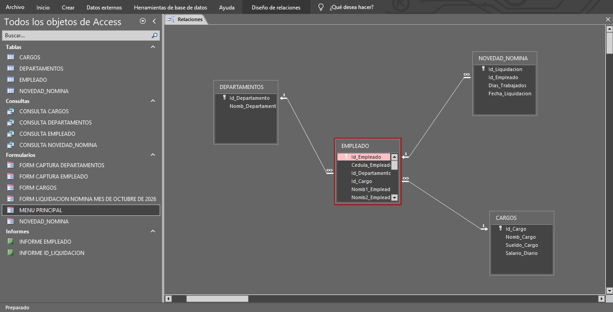
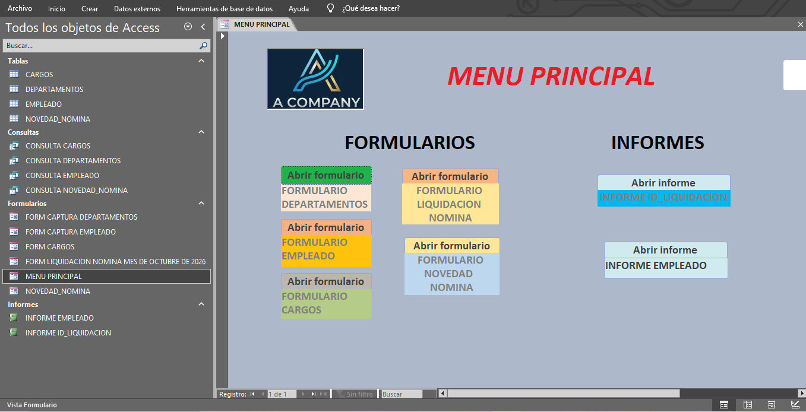
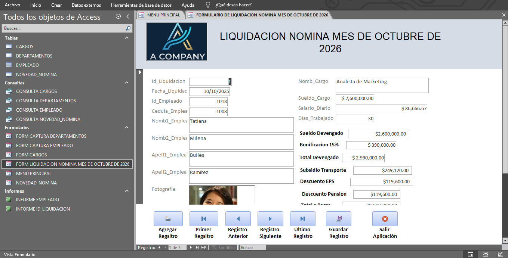
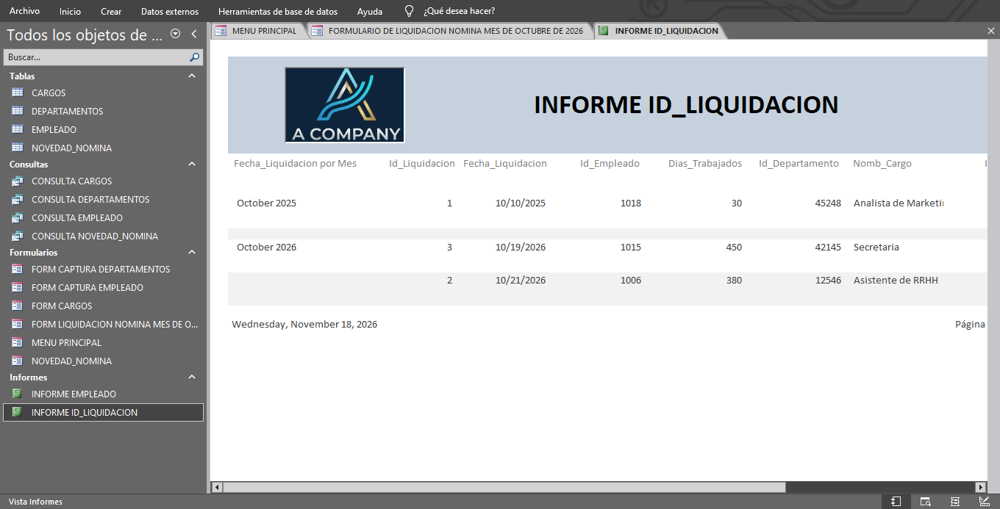

# Payroll & HR Relational Database System (Microsoft Access)

Relational database designed and implemented to manage human resources records, payroll updates, and automated reporting for a 23-employee organization (**A Company**).

## Key Features
- **Normalized Relational Schema:** Four core tables (`EMPLEADO`, `CARGOS`, `DEPARTAMENTOS`, `NOVEDAD_NOMINA`) linked through primary and foreign keys.
- **Automated Payroll Logic:** Queries (`CONSULTA NOVEDAD_NOMINA`, `CONSULTA EMPLEADO`) and calculated fields for payroll updates, worked days, total earnings (*Total Devengado*), and deductions.
- **Interactive Navigation Forms:** Custom interfaces including a central `MENU PRINCIPAL`, data-entry forms, and monthly payroll settlement forms (`FORM LIQUIDACION NOMINA`).
- **Automated Reporting:** Formatted summary reports (`INFORME EMPLEADO`, `INFORME ID_LIQUIDACION`) ready for administrative review.

## Database Preview

### Entity-Relationship Diagram

### Main Navigation Menu

### Monthly Payroll Settlement Form

### Automated Payroll Report

## Technologies
- Microsoft Access (`.accdb`)
- Relational Database Design & SQL Queries
